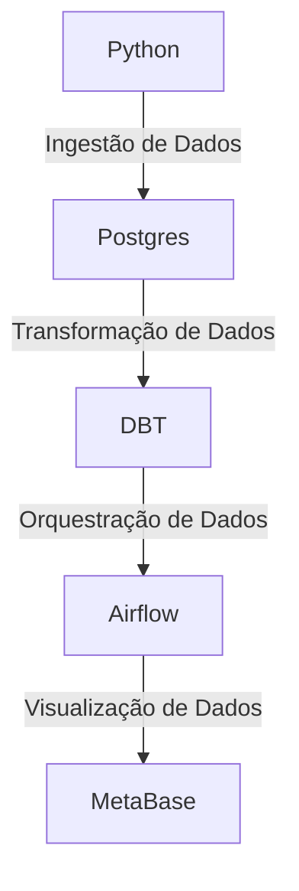

# Projeto: Criacao de um Data Warehouse com DBT + Postgres + Airflow

> Projeto desenvolvido com o objetivo de simular um ambiente produtivo de um data warehouse corporativo, utilizando ferramentas modernas de ETL e orquestração de dados.

## Arquitetura do Projeto


1. **Ingestão de Dados**: Utilizamos Python para extrair dados de diferentes fontes da pasta `data/` e carregá-los no banco de dados Postgres.
2. **Transformação de Dados**: Utilizamos DBT (Data Build Tool) para transformar os dados brutos carregados no Postgres em modelos analíticos prontos para consumo.
3. **Orquestração de Dados**: Utilizamos Airflow para agendar e monitorar os pipelines de ETL, garantindo que os dados sejam processados de forma eficiente e confiável.
4. **Visualização de Dados**: Os dados transformados podem ser visualizados utilizando o MetaBase, para gerar insights e relatórios.


## Como Executar o Projeto

### Pré-requisitos
- Docker e Docker Compose instalados na sua máquina.

### Passos para Executar
1. Clone este repositório:
    ```bash
    git clone <repository_url>
    cd <repository_name>
    ```
2. Inicie os serviços utilizando Docker Compose:
    ```bash
    docker-compose up -d
    ```
3. Acesse o Airflow através do navegador:
    - URL: `http://localhost:8080`
4. Acesse o Postgres através do navegador ou de um cliente SQL:
    - Host: `localhost`
    - Port: `5432`
    - User: `postgres`
    - Password: `postgres`
5. Acesse o DBT através do terminal:
    ```bash
    docker exec -it <dbt_container_name> bash
    dbt run
    ```
6. Acesse o MetaBase através do navegador:
    - URL: `http://localhost:3000`

## Estrutura de Pastas
```
├── data/                  # Pasta contendo os arquivos de dados brutos
├── dbt/                   # Pasta contendo os modelos e configurações do DBT
├── airflow/               # Pasta contendo as DAGs e configurações do Airflow
├── metabase/              # Pasta contendo as configurações do MetaBase
├── docker-compose.yml     # Arquivo de configuração do Docker Compose
├── README.md              # Este arquivo de documentação
```

## Como criar um PR

1. Faça um clone do repositório.
2. Crie uma nova branch com suas alterações: `git checkout -b feature/nova-feature`.
3. Commit suas alterações: `git commit -am 'Adiciona nova feature'`.
4. Push para a branch: `git push origin feature/nova-feature`.
5. Abra um Pull Request no GitHub.

### Checklist para Pull Request
- [ ] O código segue as convenções de estilo do projeto.
- [ ] Foram adicionados testes para as novas funcionalidades.
- [ ] A documentação foi atualizada conforme necessário.
- [ ] O Pull Request foi revisado por pelo menos um membro da equipe.
- [ ] Todos os testes passam localmente com coverage de 90% de cobertura antes de abrir o Pull Request.

## Material Complementar
- [Documentação do DBT](https://docs.getdbt.com/)
- [Documentação do Airflow](https://airflow.apache.org/docs/)
- [Documentação do Postgres](https://www.postgresql.org/docs/)
- [Documentação do MetaBase](https://www.metabase.com/docs/latest/)
- [Docker Compose](https://docs.docker.com/compose/)
- [Python](https://www.python.org/doc/)
- [Curso Python - Gratuito](https://www.datascienceacademy.com.br/cursosgratuitos)
- [Curso Python - Pago](https://www.udemy.com/course/curso-de-programacao-em-python-do-basico-ao-avancado/)
- [Curso Engenharia de Dados Basico](https://www.datascienceacademy.com.br/cursosgratuitos)
- [Livro Programador Autodidata](https://www.amazon.com.br/Programador-Autodidata-definitivo-programar-profissionalmente-ebook/dp/B0BJL4DHCZ)
- [Livro Cientista da Computação Autodidata](https://www.amazon.com.br/Cientista-Computação-Autodidata-estruturas-algoritmos-ebook/dp/B0BJL56F1C)
- [Livro Fundamentos da Engenharia de Dados](https://www.amazon.com.br/Fundamentos-Engenharia-Dados-Construa-Sistemas/dp/8575228765)
- [Livro Decifrando Arquitetura de Dados](https://www.amazon.com.br/Decifrando-Arquiteturas-Dados-Escolhendo-warehouse-ebook/dp/B0DDQKCNBJ)
- [Livro The Data Warehouse Toolkit](https://www.amazon.com.br/Data-Warehouse-Toolkit-Definitive-Dimensional-ebook/dp/B00DRZX6XS)
- [Curso DBT Fundamentals + Certification](https://learn.getdbt.com/courses/dbt-fundamentals)

## Dicas
- Sempre teste suas alterações localmente antes de abrir um Pull Request.
- Ao modelar o Data Warehouse busque criar tabelas dimensionais de diferentes tipos e características, como Slowly Changing Dimensions (SCD) e tabelas de fatos. Lembre-se de criar uma dimensão de tempo (time dimension) para facilitar análises temporais.
- Crie tests no DBT para garantir a qualidade dos dados e evitar problemas futuros.
- A biblioteca Pandas do Python é uma ferramenta poderosa para manipulação de dados, aproveite-a para fazer a ingestão dos dados na camada staging no Postgres. Uma boa prática é adicionar metadados, no minimo, com a data e hora da ingestão dos dados para rastreabilidade.
- Ao criar as DAGs no Airflow, utilize boas práticas de organização e modularização do código, criando funções reutilizáveis e mantendo a legibilidade do código.