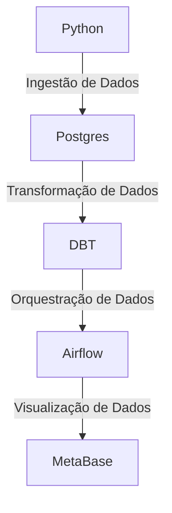

# Projeto: Criacao de um Data Warehouse com DBT + Postgres + Airflow

> Projeto desenvolvido com o objetivo de simular um ambiente produtivo de um data warehouse corporativo, utilizando ferramentas modernas de ETL e orquestração de dados.

## Arquitetura do Projeto


1. **Ingestão de Dados**: Utilizamos Python para extrair dados de diferentes fontes da pasta `data/` e carregá-los no banco de dados Postgres.
2. **Transformação de Dados**: Utilizamos DBT (Data Build Tool) para transformar os dados brutos carregados no Postgres em modelos analíticos prontos para consumo.
3. **Orquestração de Dados**: Utilizamos Airflow para agendar e monitorar os pipelines de ETL, garantindo que os dados sejam processados de forma eficiente e confiável.
4. **Visualização de Dados**: Os dados transformados podem ser visualizados utilizando o MetaBase, para gerar insights e relatórios.


## Como Executar o Projeto

### Pré-requisitos
- Docker e Docker Compose instalados na sua máquina.
- Python 3.12 (para rodar testes e linters localmente).
- Git e acesso ao repositório no GitHub.

### Passos para Executar
1. Clone este repositório:
    ```bash
    git clone https://github.com/julioszeferino/ementor-ricardo.git
    cd ementor-ricardo
    ```
2. Crie o arquivo de variáveis de ambiente a partir do exemplo (o `.env` nunca vai para o git):
    ```bash
    cp .env.example .env
    ```
3. Suba os serviços:
    ```bash
    docker compose up -d --build
    docker compose ps          # airflow-init deve terminar com "Exited (0)", os demais "healthy"
    ```
4. Acesse o Airflow: `http://localhost:8080` (usuário/senha definidos no `.env`, padrão `airflow` / `airflow`).
5. Acesse o Postgres por um cliente SQL:
    - Host: `localhost` | Port: `5432` | Database: `warehouse`
    - User/Password: `DW_USER` / `DW_PASSWORD` do `.env` (padrão `postgres` / `postgres`)
    - Schemas já criados: `raw`, `staging`, `intermediate`, `marts`, `snapshots`
6. Rode a ingestão manualmente (fora do Airflow):
    ```bash
    docker compose --profile jobs run --rm ingestion
    ```
7. Acesse o dbt pelo terminal:
    ```bash
    docker compose exec dbt bash
    dbt debug     # valida a conexão
    dbt build     # roda modelos + testes
    ```
8. Acesse o Metabase: `http://localhost:3000` (veja `metabase/README.md` para conectar ao DW).

Para parar: `docker compose down`. Para apagar também os dados: `docker compose down -v`.

## Estrutura de Pastas
```
├── data/                      # Arquivos de dados brutos (somente leitura, sujeira proposital)
├── src/ingestion/             # Pacote Python de ingestão (config, metadados, loader, main)
├── tests/                     # Testes unitários da ingestão
├── dbt/                       # Projeto dbt (models/staging|intermediate|marts, snapshots, tests)
├── airflow/
│   ├── dags/                  # DAGs (exemplo: dw_pipeline.py)
│   ├── tests/                 # Testes de integridade das DAGs
│   └── Dockerfile             # Airflow 3 + venv com ingestão e dbt
├── metabase/                  # Instruções de configuração do Metabase
├── postgres/                  # Scripts SQL de inicialização dos bancos
├── docker/tools/Dockerfile    # Imagem dos serviços ingestion e dbt
├── scripts/                   # Utilitários do mentor (proteção da branch master)
├── .github/                   # CI, template de PR, CODEOWNERS, Dependabot
├── docker-compose.yml         # Stack completa
├── pyproject.toml / uv.lock   # Dependências e configuração de ruff, mypy e pytest
├── AGENTS.md                  # Instruções para agentes de IA
└── README.md                  # Este arquivo
```

### Por onde começar
O esqueleto já roda; o desafio é preencher:
1. **Ingestão** (`src/ingestion/`): uma pipeline por arquivo de `data/`, registrada em `PIPELINES` no `main.py`, com testes. Use `add_ingestion_metadata` e `load_dataframe`.
2. **dbt** (`dbt/`): `stg_clientes` é o exemplo. Crie `stg_produtos`, `stg_vendas`, as dimensões (incluindo `dim_tempo` e uma SCD2 via snapshot) e a fato de vendas, todos com testes.
3. **Airflow**: a DAG `dw_pipeline` já encadeia ingestão → `dbt build`; evolua conforme necessário.
4. **Segurança**: crie os roles de menor privilégio (TODO em `postgres/init/01_schemas.sql`).
5. **Metabase**: dashboard de vendas consumindo o schema `marts`.

## Rodando os testes localmente

Rode tudo isto **antes de abrir um PR**. São exatamente as mesmas verificações da esteira de CI; se algo falhar aqui, vai falhar no PR.

### 1. Criar o ambiente virtual (.venv)
O projeto usa o [uv](https://docs.astral.sh/uv/) para gerenciar dependências.

```bash
# macOS / Linux
python3.12 -m venv .venv
source .venv/bin/activate
pip install uv==0.13.0
uv sync --group dbt          # instala dependências de runtime, dev (pytest, ruff, mypy, sqlfluff) e dbt no .venv
```

```powershell
# Windows (PowerShell)
py -3.12 -m venv .venv
.venv\Scripts\Activate.ps1
pip install uv==0.13.0
uv sync --group dbt
```

> Se já tiver o uv instalado globalmente, basta `uv sync --group dbt`: ele cria o `.venv` sozinho.
> Para sair do ambiente: `deactivate`.

### 2. Linters e tipagem
```bash
ruff check .                 # lint Python + regras de segurança
ruff format --check .        # formatação (rode "ruff format ." para corrigir)
mypy                         # tipagem estrita em src/
sqlfluff lint dbt/           # lint dos modelos SQL (rode "sqlfluff fix dbt/" para corrigir)
```

### 3. Testes unitários e cobertura
```bash
pytest                       # falha se a cobertura ficar abaixo de 90%
pytest --cov-report=html     # relatório navegável em htmlcov/index.html
```

### 4. dbt
```bash
export DW_PASSWORD=postgres  # Windows: $env:DW_PASSWORD="postgres"
dbt parse --project-dir dbt --profiles-dir dbt           # valida sintaxe e referências (não precisa de banco)
dbt build --project-dir dbt --profiles-dir dbt           # modelos + testes (precisa do Postgres no ar)
```

### 5. DAGs do Airflow
Com a stack no ar (`docker compose up -d`):
```bash
docker compose exec airflow-scheduler python -m pytest /opt/airflow/tests -p no:cacheprovider
```

### 6. Checklist de saída
Se todos os comandos acima passaram, faça o commit e o push da sua branch e abra o PR.

## Como criar um PR

A branch `master` é **protegida**: não aceita push direto. Todo código entra via Pull Request, com CI verde e aprovação do mentor.

1. Atualize sua master local: `git checkout master && git pull`.
2. Crie uma branch: `git checkout -b feature/ingestao-clientes`.
3. Faça commits pequenos no padrão Conventional Commits: `git commit -m "feat: adiciona ingestão de clientes"`.
4. Rode todas as verificações de [Rodando os testes localmente](#rodando-os-testes-localmente).
5. Envie a branch: `git push -u origin feature/ingestao-clientes`.
6. Abra o PR: `gh pr create --fill` (ou pela interface do GitHub) e preencha o template.
7. Aguarde a esteira (lint, test, dbt, airflow-dags, secrets) e a revisão. Ajustes pedidos entram como novos commits na mesma branch.

### Checklist para Pull Request
- [ ] O código segue as convenções de estilo do projeto.
- [ ] Foram adicionados testes para as novas funcionalidades.
- [ ] A documentação foi atualizada conforme necessário.
- [ ] O Pull Request foi revisado por pelo menos um membro da equipe.
- [ ] Todos os testes passam localmente com coverage de 90% de cobertura antes de abrir o Pull Request.

## Material Complementar
- [Documentação do DBT](https://docs.getdbt.com/)
- [Documentação do Airflow](https://airflow.apache.org/docs/)
- [Documentação do Postgres](https://www.postgresql.org/docs/)
- [Documentação do MetaBase](https://www.metabase.com/docs/latest/)
- [Docker Compose](https://docs.docker.com/compose/)
- [Python](https://www.python.org/doc/)
- [Curso Python - Gratuito](https://www.datascienceacademy.com.br/cursosgratuitos)
- [Curso Python - Pago](https://www.udemy.com/course/curso-de-programacao-em-python-do-basico-ao-avancado/)
- [Curso Engenharia de Dados Basico](https://www.datascienceacademy.com.br/cursosgratuitos)
- [Livro Programador Autodidata](https://www.amazon.com.br/Programador-Autodidata-definitivo-programar-profissionalmente-ebook/dp/B0BJL4DHCZ)
- [Livro Cientista da Computação Autodidata](https://www.amazon.com.br/Cientista-Computação-Autodidata-estruturas-algoritmos-ebook/dp/B0BJL56F1C)
- [Livro Fundamentos da Engenharia de Dados](https://www.amazon.com.br/Fundamentos-Engenharia-Dados-Construa-Sistemas/dp/8575228765)
- [Livro Decifrando Arquitetura de Dados](https://www.amazon.com.br/Decifrando-Arquiteturas-Dados-Escolhendo-warehouse-ebook/dp/B0DDQKCNBJ)
- [Livro The Data Warehouse Toolkit](https://www.amazon.com.br/Data-Warehouse-Toolkit-Definitive-Dimensional-ebook/dp/B00DRZX6XS)
- [Curso DBT Fundamentals + Certification](https://learn.getdbt.com/courses/dbt-fundamentals)

## Dicas
- Sempre teste suas alterações localmente antes de abrir um Pull Request.
- Ao modelar o Data Warehouse busque criar tabelas dimensionais de diferentes tipos e características, como Slowly Changing Dimensions (SCD) e tabelas de fatos. Lembre-se de criar uma dimensão de tempo (time dimension) para facilitar análises temporais.
- Crie tests no DBT para garantir a qualidade dos dados e evitar problemas futuros.
- A biblioteca Pandas do Python é uma ferramenta poderosa para manipulação de dados, aproveite-a para fazer a ingestão dos dados na camada staging no Postgres. Uma boa prática é adicionar metadados, no minimo, com a data e hora da ingestão dos dados para rastreabilidade.
- Ao criar as DAGs no Airflow, utilize boas práticas de organização e modularização do código, criando funções reutilizáveis e mantendo a legibilidade do código.